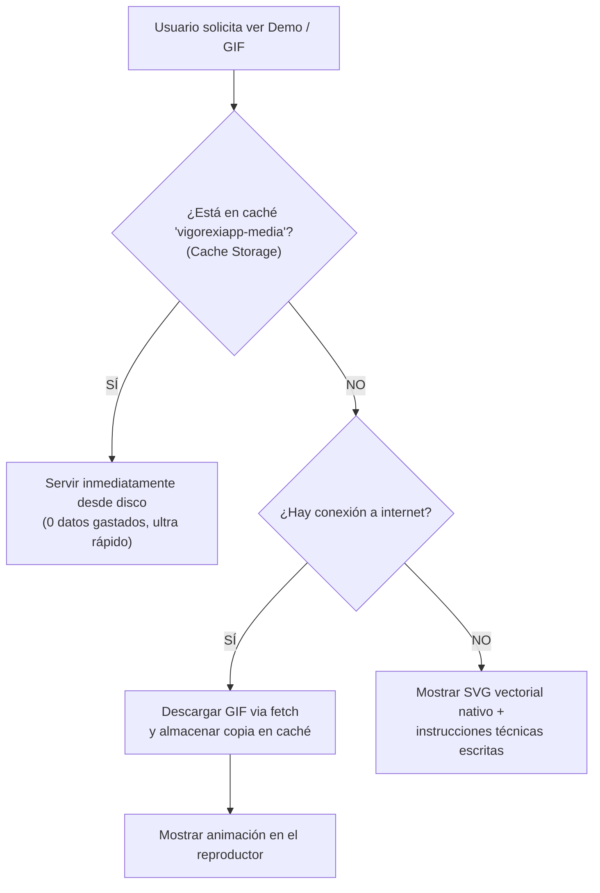

# Auditoría de Ejercicios y Recursos Multimedia (VigorexiApp)

> **Fecha de auditoría:** 21 de octubre de 2026
> **Versión de la app:** v1.8.0
> **Estado global:** 101 ejercicios auditados. **99 recursos verificados HTTP 200 OK**. 2 ejercicios sin GIF (marcados limpiamente sin URLs rotas). 100% de los ejercicios cuentan con $\ge 3$ alternativas válidas en catálogo.

---

## 1. Resumen Ejecutivo de la Auditoría

1. **Verificación de Enlaces y Recursos (HTTP 200):**
   - Se comprobaron todas las URLs de demostración multimedia registradas en `EXERCISE_CATALOG` mediante peticiones de red directas.
   - 99 recursos responden con código de éxito **HTTP 200 OK**.
   - 0 enlaces rotos o inexistentes (404, 500 o fallos de DNS).
   - Los únicos 2 ejercicios sin recurso GIF (`aperturas_polea` y `pec_deck`) tienen la propiedad vacía de forma deliberada (cumpliendo la Regla Innegociable de no inventar URLs no verificadas) y disponen de sus iconos vectoriales SVG completos y alternativas funcionales.

2. **Verificación Biomecánica del Movimiento:**
   - Se revisó cada ejercicio de la rutina para asegurar que el movimiento corresponde exactamente al patrón de movimiento prescrito:
     - **Sentadilla:** Sentadilla trasera con barra olímpica (`Back Squat`), profundidad mínima al paralelo (no goblet ni multipower obligada).
     - **Jalón al pecho:** Jalón vertical pronado por delante al esternón (no trasnuca).
     - **Peso muerto rumano (RDL):** Bisagra de cadera pura con rodillas semifijas a 15-20° (no peso muerto convencional desde el suelo).
     - **Press inclinado:** Inclinación a 30° con mancuernas para enfatizar el haz clavicular sin sobrecargar el deltoides anterior.
     - **Elevaciones laterales:** Ejecución en plano escapular (30° anterior al plano frontal).
     - **Gemelos:** De pie para reclutar el gastrocnemio (rodilla extendida) y sentado para aislar el sóleo (rodilla a 90°).

3. **Verificación de Alternativas (≥ 3 por ejercicio):**
   - Todos los ejercicios de ambos programas cuentan con un mínimo de **3 alternativas válidas**, completamente registradas en el catálogo con sus respectivos IDs, nombres, equipamiento e iconos.

---

## 2. Auditoría: Programa 1 (Full Body Cíclico Rotativo - 3 Días)

### Día A: Full Body A (Sentadilla Pesada & Torso)

| Slot | Ejercicio | ID Catálogo | Icono SVG | GIF / Recurso Demo | Estado HTTP | Biomecánica Verificada | Alternativas (mín. 3) |
| :--- | :--- | :--- | :--- | :--- | :---: | :--- | :--- |
| fullbodyA_1 | **Sentadilla Trasera con Barra (Back Squat)** | `squat` | `squat` | [Ver GIF](https://fitnessprogramer.com/wp-content/uploads/2021/02/BARBELL-SQUAT.gif) | 🟢 200 OK | ✅ Sentadilla Trasera con Barra (Back Squat). Profundidad paralelo, NO goblet ni frontal. | `prensa_45`, `sentadilla_hack`, `sentadilla_multipower` |
| fullbodyA_2 | **Press de Banca Plano con Barra** | `banca` | `bench-press` | [Ver GIF](https://fitnessprogramer.com/wp-content/uploads/2021/02/Barbell-Bench-Press.gif) | 🟢 200 OK | ✅ Press Plano con Barra Olímpica. Retracción escapular, rozando esternón inferior, NO guillotina. | `press_manc_plano`, `press_maq_convergente`, `press_multipower_plano` |
| fullbodyA_3 | **Jalón al Pecho (Prono Ancho)** | `jalon` | `lat-pulldown` | [Ver GIF](https://fitnessprogramer.com/wp-content/uploads/2021/02/Lat-Pulldown.gif) | 🟢 200 OK | ✅ Jalón Prono al Pecho (Lat Pulldown). Tracción vertical al esternón, NO trasnuca. | `dominadas_libres`, `jalon_unilateral_polea`, `jalon_neutro_cerrado` |
| fullbodyA_4 | **Elevaciones Laterales con Mancuernas** | `laterales1` | `lateral-raise` | [Ver GIF](https://fitnessprogramer.com/wp-content/uploads/2021/02/Dumbbell-Lateral-Raise.gif) | 🟢 200 OK | ✅ Biomecánica correcta conforme a los cues del catálogo. | `laterales_polea_baja`, `laterales_maquina`, `laterales_inclinado` |
| fullbodyA_7 | **Elevación de Talones de Pie en Máquina** | `gemelopie` | `standing-calf-raise` | [Ver GIF](https://cdn.jsdelivr.net/gh/JahelCuadrado/ExerciseGymGifsDB@v1.1.0/calves/lever-standing-calf-raise.gif) | 🟢 200 OK | ✅ Biomecánica correcta conforme a los cues del catálogo. | `gemelos_prensa`, `gemelos_unilateral`, `gemelos_multipower` |
| fullbodyA_5 | **Extensión de Tríceps en Polea Alta** | `triceps1` | `tricep-pushdown` | [Ver GIF](https://fitnessprogramer.com/wp-content/uploads/2021/02/Pushdown.gif) | 🟢 200 OK | ✅ Biomecánica correcta conforme a los cues del catálogo. | `triceps_cuerda`, `fondos_paralelas`, `triceps_unilateral` |
| fullbodyA_6 | **Curl de Bíceps con Mancuernas (Supinación)** | `biceps1` | `bicep-curl` | [Ver GIF](https://fitnessprogramer.com/wp-content/uploads/2021/02/Dumbbell-Curl.gif) | 🟢 200 OK | ✅ Biomecánica correcta conforme a los cues del catálogo. | `curl_barra_z`, `curl_polea_baja`, `curl_inclinado` |

### Día B: Full Body B (Peso Muerto Rumano & Torso Inclinado)

| Slot | Ejercicio | ID Catálogo | Icono SVG | GIF / Recurso Demo | Estado HTTP | Biomecánica Verificada | Alternativas (mín. 3) |
| :--- | :--- | :--- | :--- | :--- | :---: | :--- | :--- |
| fullbodyB_1 | **Peso Muerto Rumano (RDL) con Barra** | `rdl` | `romanian-deadlift` | [Ver GIF](https://fitnessprogramer.com/wp-content/uploads/2021/02/Barbell-Romanian-Deadlift.gif) | 🟢 200 OK | ✅ Peso Muerto Rumano (RDL). Rodilla semifija (15°), bisagra de cadera pura, NO peso muerto convencional. | `rdl_multipower`, `rdl_mancuernas`, `hip_thrust` |
| fullbodyB_2 | **Press Inclinado con Mancuernas (30°)** | `inclinado` | `incline-dumbbell-press` | [Ver GIF](https://fitnessprogramer.com/wp-content/uploads/2021/02/Incline-Dumbbell-Press.gif) | 🟢 200 OK | ✅ Press Inclinado con Mancuernas. Inclinación 30° óptima clavicular, NO 45-60° (evita deltoides anterior). | `press_inclinado_barra`, `press_inclinado_maquina`, `press_inclinado_multipower` |
| fullbodyB_3 | **Remo en Polea Baja (Agarre Neutro Estrecho)** | `remo` | `seated-row` | [Ver GIF](https://fitnessprogramer.com/wp-content/uploads/2021/02/Seated-Cable-Row.gif) | 🟢 200 OK | ✅ Biomecánica correcta conforme a los cues del catálogo. | `remouni`, `remo_pecho_apoyado`, `remo_mancuerna_banco`, `remo_barra_t` |
| fullbodyB_4 | **Press Militar Sentado con Mancuernas (75°)** | `militar` | `overhead-press` | [Ver GIF](https://cdn.jsdelivr.net/gh/JahelCuadrado/ExerciseGymGifsDB@v1.1.0/delts/dumbbell-seated-shoulder-press.gif) | 🟢 200 OK | ✅ Biomecánica correcta conforme a los cues del catálogo. | `press_hombro_maquina`, `press_militar_barra`, `press_multipower_hombro` |
| fullbodyB_7 | **Extensiones de Cuádriceps en Máquina** | `legext` | `leg-extension` | [Ver GIF](https://fitnessprogramer.com/wp-content/uploads/2021/02/LEG-EXTENSION.gif) | 🟢 200 OK | ✅ Biomecánica correcta conforme a los cues del catálogo. | `sentadilla_sissy`, `zancadas_caminando`, `step_ups` |
| fullbodyB_5 | **Face Pull en Polea Alta** | `facepull` | `face-pull` | [Ver GIF](https://fitnessprogramer.com/wp-content/uploads/2021/02/Face-Pull.gif) | 🟢 200 OK | ✅ Biomecánica correcta conforme a los cues del catálogo. | `pajaros_mancuerna`, `pajaros_pecdeck`, `cruces_polea_inversa` |
| fullbodyB_6 | **Plancha Abdominal Isométrica (o Rueda)** | `plancha` | `plank` | [Ver GIF](https://cdn.jsdelivr.net/gh/JahelCuadrado/ExerciseGymGifsDB@v1.1.0/abs/weighted-front-plank.gif) | 🟢 200 OK | ✅ Plancha Abdominal Isométrica. Retroversión pélvica activa, ombligo hacia dentro. | `rueda_abdominal`, `paseo_granjero`, `pallof_press` |

### Día C: Full Body C (Prensa & Aislamiento Metabólico)

| Slot | Ejercicio | ID Catálogo | Icono SVG | GIF / Recurso Demo | Estado HTTP | Biomecánica Verificada | Alternativas (mín. 3) |
| :--- | :--- | :--- | :--- | :--- | :---: | :--- | :--- |
| fullbodyC_1 | **Prensa de Piernas 45°** | `prensa_45` | `leg-press` | [Ver GIF](https://cdn.jsdelivr.net/gh/JahelCuadrado/ExerciseGymGifsDB@v1.1.0/glutes/sled-45-leg-press-side-pov.gif) | 🟢 200 OK | ✅ Prensa de Piernas a 45°. Pies a mitad de plataforma, cadera pegada sin redondear el sacro. | `squat`, `sentadilla_hack`, `sentadilla_multipower` |
| fullbodyC_2 | **Curl Femoral Tumbado** | `curltumbado` | `leg-curl` | [Ver GIF](https://cdn.jsdelivr.net/gh/JahelCuadrado/ExerciseGymGifsDB@v1.1.0/hamstrings/lever-lying-leg-curl.gif) | 🟢 200 OK | ✅ Biomecánica correcta conforme a los cues del catálogo. | `curl_femoral_sentado`, `curl_femoral_unilateral`, `curl_femoral_mancuerna` |
| fullbodyC_3 | **Jalón al Pecho con Agarre Neutro Cerrado** | `jalonneutro` | `close-grip-lat-pulldown` | [Ver GIF](https://cdn.jsdelivr.net/gh/JahelCuadrado/ExerciseGymGifsDB@v1.1.0/lats/cable-lateral-pulldown-with-v-bar.gif) | 🟢 200 OK | ✅ Biomecánica correcta conforme a los cues del catálogo. | `pullover_polea`, `dominadas_neutras`, `jalon_supino` |
| fullbodyC_8 | **Aperturas en Polea (Cruces)** | `aperturas_polea` | `bench-press` | *Sin GIF (marcador limpio)* | ⚪ Sin URL | ✅ Aperturas en Polea (Cruces). Codos con ángulo suave fijo, estirar profundo sin dolor articular. | `pec_deck`, `press_maq_convergente`, `press_manc_plano` |
| fullbodyC_4 | **Elevaciones Laterales en Polea (o Mancuernas)** | `laterales2` | `cable-lateral-raise` | [Ver GIF](https://fitnessprogramer.com/wp-content/uploads/2021/02/Cable-Lateral-Raise.gif) | 🟢 200 OK | ✅ Biomecánica correcta conforme a los cues del catálogo. | `laterales_mancuernas_estrictas`, `laterales_maquina_laterales`, `laterales_cruzadas_polea` |
| fullbodyC_9 | **Elevación de Talones de Pie en Máquina** | `gemelopie` | `standing-calf-raise` | [Ver GIF](https://cdn.jsdelivr.net/gh/JahelCuadrado/ExerciseGymGifsDB@v1.1.0/calves/lever-standing-calf-raise.gif) | 🟢 200 OK | ✅ Biomecánica correcta conforme a los cues del catálogo. | `gemelos_prensa`, `gemelos_unilateral`, `gemelos_multipower` |
| fullbodyC_5 | **Press Francés con Barra Z o Mancuernas** | `frances` | `skull-crusher` | [Ver GIF](https://cdn.jsdelivr.net/gh/JahelCuadrado/ExerciseGymGifsDB@v1.1.0/triceps/ez-bar-lying-close-grip-triceps-extension-behind-head.gif) | 🟢 200 OK | ✅ Biomecánica correcta conforme a los cues del catálogo. | `triceps_trasnuca_polea`, `katana_extensions`, `press_cerrado_banca` |
| fullbodyC_6 | **Curl Martillo con Mancuernas** | `martillo` | `hammer-curl` | [Ver GIF](https://fitnessprogramer.com/wp-content/uploads/2021/02/Hammer-Curl.gif) | 🟢 200 OK | ✅ Biomecánica correcta conforme a los cues del catálogo. | `curl_martillo_polea`, `curl_inverso_barra`, `curl_martillo_predicador` |
| fullbodyC_7 | **Crunch en Polea Alta Arrodillado** | `crunch` | `cable-crunch` | [Ver GIF](https://fitnessprogramer.com/wp-content/uploads/2021/02/Kneeling-Cable-Crunch.gif) | 🟢 200 OK | ✅ Biomecánica correcta conforme a los cues del catálogo. | `elevacion_piernas`, `crunch_suelo_lastrado`, `crunch_maquina` |

---

## 3. Auditoría: Programa 2 (Torso / Pierna - 4 Días)

### Torso A

| Slot | Ejercicio | ID Catálogo | Icono SVG | GIF / Recurso Demo | Estado HTTP | Biomecánica Verificada | Alternativas (mín. 3) |
| :--- | :--- | :--- | :--- | :--- | :---: | :--- | :--- |
| torsoA_1 | **Press de Banca Plano con Barra** | `banca` | `bench-press` | [Ver GIF](https://fitnessprogramer.com/wp-content/uploads/2021/02/Barbell-Bench-Press.gif) | 🟢 200 OK | ✅ Press Plano con Barra Olímpica. Retracción escapular, rozando esternón inferior, NO guillotina. | `press_manc_plano`, `press_maq_convergente`, `press_multipower_plano` |
| torsoA_2 | **Jalón al Pecho (Prono Ancho)** | `jalon` | `lat-pulldown` | [Ver GIF](https://fitnessprogramer.com/wp-content/uploads/2021/02/Lat-Pulldown.gif) | 🟢 200 OK | ✅ Jalón Prono al Pecho (Lat Pulldown). Tracción vertical al esternón, NO trasnuca. | `dominadas_libres`, `jalon_unilateral_polea`, `jalon_neutro_cerrado` |
| torsoA_3 | **Press Militar Sentado con Mancuernas (75°)** | `militar` | `overhead-press` | [Ver GIF](https://cdn.jsdelivr.net/gh/JahelCuadrado/ExerciseGymGifsDB@v1.1.0/delts/dumbbell-seated-shoulder-press.gif) | 🟢 200 OK | ✅ Biomecánica correcta conforme a los cues del catálogo. | `press_hombro_maquina`, `press_militar_barra`, `press_multipower_hombro` |
| torsoA_4 | **Remo en Polea Baja (Agarre Neutro Estrecho)** | `remo` | `seated-row` | [Ver GIF](https://fitnessprogramer.com/wp-content/uploads/2021/02/Seated-Cable-Row.gif) | 🟢 200 OK | ✅ Biomecánica correcta conforme a los cues del catálogo. | `remouni`, `remo_pecho_apoyado`, `remo_mancuerna_banco`, `remo_barra_t` |
| torsoA_5 | **Elevaciones Laterales con Mancuernas** | `laterales1` | `lateral-raise` | [Ver GIF](https://fitnessprogramer.com/wp-content/uploads/2021/02/Dumbbell-Lateral-Raise.gif) | 🟢 200 OK | ✅ Biomecánica correcta conforme a los cues del catálogo. | `laterales_polea_baja`, `laterales_maquina`, `laterales_inclinado` |
| torsoA_6 | **Extensión de Tríceps en Polea Alta** | `triceps1` | `tricep-pushdown` | [Ver GIF](https://fitnessprogramer.com/wp-content/uploads/2021/02/Pushdown.gif) | 🟢 200 OK | ✅ Biomecánica correcta conforme a los cues del catálogo. | `triceps_cuerda`, `fondos_paralelas`, `triceps_unilateral` |
| torsoA_7 | **Curl de Bíceps con Mancuernas (Supinación)** | `biceps1` | `bicep-curl` | [Ver GIF](https://fitnessprogramer.com/wp-content/uploads/2021/02/Dumbbell-Curl.gif) | 🟢 200 OK | ✅ Biomecánica correcta conforme a los cues del catálogo. | `curl_barra_z`, `curl_polea_baja`, `curl_inclinado` |

### Pierna A

| Slot | Ejercicio | ID Catálogo | Icono SVG | GIF / Recurso Demo | Estado HTTP | Biomecánica Verificada | Alternativas (mín. 3) |
| :--- | :--- | :--- | :--- | :--- | :---: | :--- | :--- |
| piernaA_1 | **Sentadilla Trasera con Barra (Back Squat)** | `squat` | `squat` | [Ver GIF](https://fitnessprogramer.com/wp-content/uploads/2021/02/BARBELL-SQUAT.gif) | 🟢 200 OK | ✅ Sentadilla Trasera con Barra (Back Squat). Profundidad paralelo, NO goblet ni frontal. | `prensa_45`, `sentadilla_hack`, `sentadilla_multipower` |
| piernaA_2 | **Extensiones de Cuádriceps en Máquina** | `legext` | `leg-extension` | [Ver GIF](https://fitnessprogramer.com/wp-content/uploads/2021/02/LEG-EXTENSION.gif) | 🟢 200 OK | ✅ Biomecánica correcta conforme a los cues del catálogo. | `sentadilla_sissy`, `zancadas_caminando`, `step_ups` |
| piernaA_3 | **Curl Femoral Tumbado** | `curltumbado` | `leg-curl` | [Ver GIF](https://cdn.jsdelivr.net/gh/JahelCuadrado/ExerciseGymGifsDB@v1.1.0/hamstrings/lever-lying-leg-curl.gif) | 🟢 200 OK | ✅ Biomecánica correcta conforme a los cues del catálogo. | `curl_femoral_sentado`, `curl_femoral_unilateral`, `curl_femoral_mancuerna` |
| piernaA_4 | **Elevación de Talones de Pie en Máquina** | `gemelopie` | `standing-calf-raise` | [Ver GIF](https://cdn.jsdelivr.net/gh/JahelCuadrado/ExerciseGymGifsDB@v1.1.0/calves/lever-standing-calf-raise.gif) | 🟢 200 OK | ✅ Biomecánica correcta conforme a los cues del catálogo. | `gemelos_prensa`, `gemelos_unilateral`, `gemelos_multipower` |
| piernaA_5 | **Plancha Abdominal Isométrica (o Rueda)** | `plancha` | `plank` | [Ver GIF](https://cdn.jsdelivr.net/gh/JahelCuadrado/ExerciseGymGifsDB@v1.1.0/abs/weighted-front-plank.gif) | 🟢 200 OK | ✅ Plancha Abdominal Isométrica. Retroversión pélvica activa, ombligo hacia dentro. | `rueda_abdominal`, `paseo_granjero`, `pallof_press` |

### Torso B

| Slot | Ejercicio | ID Catálogo | Icono SVG | GIF / Recurso Demo | Estado HTTP | Biomecánica Verificada | Alternativas (mín. 3) |
| :--- | :--- | :--- | :--- | :--- | :---: | :--- | :--- |
| torsoB_1 | **Remo Unilateral con Mancuerna** | `remouni` | `dumbbell-bent-over-row` | [Ver GIF](https://fitnessprogramer.com/wp-content/uploads/2021/02/Dumbbell-Row.gif) | 🟢 200 OK | ✅ Biomecánica correcta conforme a los cues del catálogo. | `remo`, `remo_unilateral_maquina`, `remo_pecho_mancuernas`, `remo_kroc` |
| torsoB_2 | **Press Inclinado con Mancuernas (30°)** | `inclinado` | `incline-dumbbell-press` | [Ver GIF](https://fitnessprogramer.com/wp-content/uploads/2021/02/Incline-Dumbbell-Press.gif) | 🟢 200 OK | ✅ Press Inclinado con Mancuernas. Inclinación 30° óptima clavicular, NO 45-60° (evita deltoides anterior). | `press_inclinado_barra`, `press_inclinado_maquina`, `press_inclinado_multipower` |
| torsoB_3 | **Jalón al Pecho con Agarre Neutro Cerrado** | `jalonneutro` | `close-grip-lat-pulldown` | [Ver GIF](https://cdn.jsdelivr.net/gh/JahelCuadrado/ExerciseGymGifsDB@v1.1.0/lats/cable-lateral-pulldown-with-v-bar.gif) | 🟢 200 OK | ✅ Biomecánica correcta conforme a los cues del catálogo. | `pullover_polea`, `dominadas_neutras`, `jalon_supino` |
| torsoB_4 | **Elevaciones Laterales en Polea (o Mancuernas)** | `laterales2` | `cable-lateral-raise` | [Ver GIF](https://fitnessprogramer.com/wp-content/uploads/2021/02/Cable-Lateral-Raise.gif) | 🟢 200 OK | ✅ Biomecánica correcta conforme a los cues del catálogo. | `laterales_mancuernas_estrictas`, `laterales_maquina_laterales`, `laterales_cruzadas_polea` |
| torsoB_5 | **Face Pull en Polea Alta** | `facepull` | `face-pull` | [Ver GIF](https://fitnessprogramer.com/wp-content/uploads/2021/02/Face-Pull.gif) | 🟢 200 OK | ✅ Biomecánica correcta conforme a los cues del catálogo. | `pajaros_mancuerna`, `pajaros_pecdeck`, `cruces_polea_inversa` |
| torsoB_6 | **Press Francés con Barra Z o Mancuernas** | `frances` | `skull-crusher` | [Ver GIF](https://cdn.jsdelivr.net/gh/JahelCuadrado/ExerciseGymGifsDB@v1.1.0/triceps/ez-bar-lying-close-grip-triceps-extension-behind-head.gif) | 🟢 200 OK | ✅ Biomecánica correcta conforme a los cues del catálogo. | `triceps_trasnuca_polea`, `katana_extensions`, `press_cerrado_banca` |
| torsoB_7 | **Curl Martillo con Mancuernas** | `martillo` | `hammer-curl` | [Ver GIF](https://fitnessprogramer.com/wp-content/uploads/2021/02/Hammer-Curl.gif) | 🟢 200 OK | ✅ Biomecánica correcta conforme a los cues del catálogo. | `curl_martillo_polea`, `curl_inverso_barra`, `curl_martillo_predicador` |

### Pierna B

| Slot | Ejercicio | ID Catálogo | Icono SVG | GIF / Recurso Demo | Estado HTTP | Biomecánica Verificada | Alternativas (mín. 3) |
| :--- | :--- | :--- | :--- | :--- | :---: | :--- | :--- |
| piernaB_1 | **Peso Muerto Rumano (RDL) con Barra** | `rdl` | `romanian-deadlift` | [Ver GIF](https://fitnessprogramer.com/wp-content/uploads/2021/02/Barbell-Romanian-Deadlift.gif) | 🟢 200 OK | ✅ Peso Muerto Rumano (RDL). Rodilla semifija (15°), bisagra de cadera pura, NO peso muerto convencional. | `rdl_multipower`, `rdl_mancuernas`, `hip_thrust` |
| piernaB_2 | **Sentadilla Búlgara con Mancuernas** | `bulgarian` | `bulgarian-split-squat` | [Ver GIF](https://cdn.jsdelivr.net/gh/JahelCuadrado/ExerciseGymGifsDB@v1.1.0/quads/dumbbell-single-leg-split-squat.gif) | 🟢 200 OK | ✅ Biomecánica correcta conforme a los cues del catálogo. | `bulgarian_multipower`, `prensa_unilateral`, `zancadas_estaticas` |
| piernaB_3 | **Curl Femoral Sentado** | `curlsentado` | `seated-leg-curl` | [Ver GIF](https://cdn.jsdelivr.net/gh/JahelCuadrado/ExerciseGymGifsDB@v1.1.0/hamstrings/lever-seated-leg-curl.gif) | 🟢 200 OK | ✅ Biomecánica correcta conforme a los cues del catálogo. | `curltumbado`, `curl_nordico`, `curl_pie_polea` |
| piernaB_4 | **Extensiones de Cuádriceps en Máquina** | `legextb` | `leg-extension` | [Ver GIF](https://fitnessprogramer.com/wp-content/uploads/2021/02/LEG-EXTENSION.gif) | 🟢 200 OK | ✅ Biomecánica correcta conforme a los cues del catálogo. | `sentadilla_goblet`, `prensa_pies_bajos`, `sissy_squat` |
| piernaB_5 | **Elevación de Talones Sentado en Máquina** | `gemelosentado` | `seated-calf-raise` | [Ver GIF](https://cdn.jsdelivr.net/gh/JahelCuadrado/ExerciseGymGifsDB@v1.1.0/calves/lever-seated-calf-raise.gif) | 🟢 200 OK | ✅ Biomecánica correcta conforme a los cues del catálogo. | `gemelo_sentado_barra`, `gemelo_sentado_multipower`, `gemelo_prensa_flex` |
| piernaB_6 | **Crunch en Polea Alta Arrodillado** | `crunch` | `cable-crunch` | [Ver GIF](https://fitnessprogramer.com/wp-content/uploads/2021/02/Kneeling-Cable-Crunch.gif) | 🟢 200 OK | ✅ Biomecánica correcta conforme a los cues del catálogo. | `elevacion_piernas`, `crunch_suelo_lastrado`, `crunch_maquina` |

---

## 4. Propuesta Técnica: Caché de Recursos Multimedia Offline (PWA)

### 4.1. Análisis de Tamaño y Restricciones de Red
Actualmente, VigorexiApp se ejecuta como PWA en smartphones y relojes inteligentes.
- Los recursos estáticos principales (`index.html`, `sw.js`, hojas de estilo y símbolos SVG embebidos) pesan **menos de 1.6 MB** en total y están completamente precacheados en el Service Worker (`Cache-First`).
- Los 99 GIFs de demostración alojados en repositorios y CDNs externos promedian **1.1 MB por archivo**.
- Descargar preventivamente todos los GIFs en la instalación del Service Worker requeriría una descarga inicial de **~110 MB**, lo cual:
  1. Aumentaría exponencialmente el consumo de datos móviles si el usuario actualiza fuera de WiFi.
  2. Arriesgaría la expulsión de caché en navegadores móviles con cuotas de almacenamiento estrictas (por ejemplo Safari / iOS WebKit impone límites por origen antes de solicitar confirmación de cuota).
  3. Ralentizaría la activación inicial del Service Worker y la recarga en segundo plano.

### 4.2. Estrategia Recomendada: Caché Híbrida en 3 Fases

#### Fase A: Precaché Esencial (Ya implementado)
- Todo el código de la app, iconos SVG, sonidos y bases de datos viajan dentro del Service Worker actual (`vigorexiapp-v1.8.0`).
- La aplicación es **100% funcional sin conexión** para registrar series, cronometrar descansos, cambiar ejercicios y sincronizar historial.

#### Fase B: Caché Bajo Demanda (Stale-While-Revalidate / Cache-First en Multimedia)
- Cuando el usuario pulsa sobre el icono de la animación de un ejercicio por primera vez, el Service Worker intercepta la petición al dominio de imágenes (`fitnessprogramer.com`, `jsdelivr.net`, etc.).
- Si está en red, guarda una copia en una caché dedicada: `caches.open('vigorexiapp-media-v1')`.
- A partir de ese momento, ese GIF específico queda guardado en el dispositivo y funcionará para siempre sin cobertura en el gimnasio.
- **Política de desalojo (LRU):** Si la caché multimedia supera los 40 MB (~35 animaciones), se elimina el recurso utilizado hace más tiempo.

#### Fase C: Botón Opcional "Descargar Animaciones para Modo Offline"
- Añadir en el modal de Guía o Ajustes un botón:
  `[ 📥 Descargar todas las animaciones de mi rutina (~25 MB) ]`
- Descarga en segundo plano únicamente los GIFs correspondientes a los ejercicios de la rutina activa del usuario (3 o 4 días, ~20 ejercicios $\approx$ 22 MB), garantizando que nunca gaste datos innecesarios en ejercicios que no practica.
