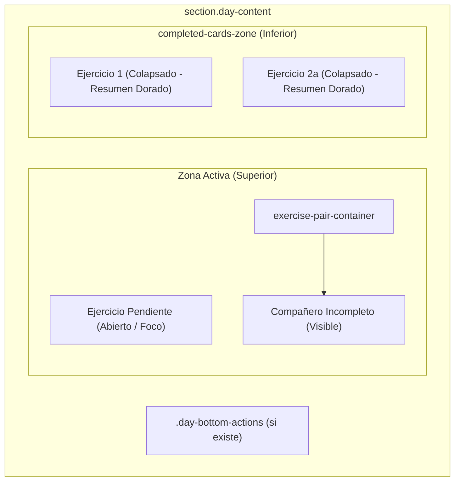

# Plan de Implementación (Hardenizado): Desplazamiento Dinámico de Ejercicios Completados al Final de la Rutina

## 1. Contexto y Requisitos Validados
En la aplicación **VigorexiApp**, cuando un ejercicio se marca como completado (todas sus series finalizadas), este debe desplazarse automáticamente a la parte inferior de la lista del día:
- **Independencia absoluta:** Cada ejercicio se mueve de forma autónoma inmediatamente al terminar sus series. Si pertenece a una superserie o biserie, el ejercicio completado baja al final y su compañero permanece arriba en la zona activa.
- **Aspecto visual actual colapsado:** Los ejercicios completados se apilan al final con su tarjeta colapsada actual (barra dorada/ámbar `#fbbf24`, check `✓`, datos de series y mejor marca).
- **Reversibilidad O(1):** Si se desmarca una serie por error o para rectificar, el ejercicio regresa de inmediato a su posición original exacta.
- **Foco superior:** El siguiente ejercicio pendiente siempre se despliega y queda enfocado arriba para entrenar sin scroll.

---

## 2. Incorporación de Correcciones de la Auditoría OpenCode

Tras la auditoría técnica de OpenCode (`opencode/deepseek-v4.1-flash-free`), se han integrado las siguientes remediaciones críticas:

1. **Aislamiento de Carreras en Timers:** Registro cancelable `pendingCardTimers = new Map()` indexado por `slotId`. Si se desmarca una serie, se resetea el día o se archiva la sesión, se cancela inmediatamente cualquier timer pendiente. Además, el callback revalida `isCardComplete(card)` antes de realizar cualquier mutación del DOM.
2. **Puntos de Integración Reales en el Código:**
   - Sustituir la referencia errónea a `restoreWorkoutInputs()` por la función real de arranque: `applyLoadedStateToUI(dayId)` (línea 15344).
   - Integrar en los flujos de fin y archivado de sesión (`executeDayArchive` y `finishDaySession`, líneas 12466-12620), asegurando que si se archiva o se reinicia la semana, los ejercicios vuelvan a su posición canónica superior.
3. **Soporte Universal de Secciones (Full Body + Torso/Pierna):**
   - Dado que los días Full Body (`fullbodyA`, `fullbodyB`, `fullbodyC`) no tienen el bloque `.day-bottom-actions` (solo presente en Torso/Pierna), la inyección de `.completed-cards-zone` utilizará:
     ```javascript
     const bottomActions = daySection.querySelector('.day-bottom-actions');
     if (bottomActions) {
       daySection.insertBefore(zone, bottomActions);
     } else {
       daySection.appendChild(zone);
     }
     ```
4. **Restauración Blindada en Parejas (`.exercise-pair-container`):**
   - El fallback de posición guardará una referencia en memoria `{ originalParent, originalNextSibling }` además del marcador DOM `<!--marker-slotId-->`, garantizando que si el marcador faltara, el ejercicio se reinserta en su contenedor de superserie original y no como hijo directo del día.
5. **Compatibilidad con Entornos de Mocking / VM:**
   - La función `resetDayWorkout` y helpers contendrán guardas defensivas (`if (typeof document !== 'undefined' && ...)`) para asegurar que tests como `tests/reset_day_test.js` (que ejecutan sandbox Node VM con DOM mockeado) sigan pasando al 100%.
6. **Bump de Versión PWA (rev45):**
   - Actualización sincronizada de caché a `rev45` en `sw.js`, `index.html` y aserciones de `tests/complete_set_test.js`.

---

## 3. Arquitectura y Mecanismo DOM



### 3.1 Función Central: `reconcileCardPosition(card, isComplete, immediate)`
```javascript
function reconcileCardPosition(card, isComplete, immediate = false) {
  if (!card) return;
  const slotId = card.getAttribute('data-slot');
  if (!slotId) return;

  // Cancelar timer previo si existía
  if (pendingCardTimers.has(slotId)) {
    clearTimeout(pendingCardTimers.get(slotId));
    pendingCardTimers.delete(slotId);
  }

  const daySection = card.closest('.day-content');
  if (!daySection) return;
  const completedZone = getOrCreateCompletedZone(daySection);

  if (isComplete) {
    const executeMove = () => {
      // Re-verificar estado en el momento de ejecución
      const rows = card.querySelectorAll('.set-row');
      const doneRows = card.querySelectorAll('.set-row.done');
      if (rows.length === 0 || doneRows.length < rows.length) return;

      if (!card.isConnected) return;
      if (card.parentNode === completedZone) return;

      // Colocar marcador en posición original si no existe
      if (!card._slotAnchor) {
        const marker = document.createComment(`marker-${slotId}`);
        card.parentNode.insertBefore(marker, card);
        card._slotAnchor = {
          marker: marker,
          parent: marker.parentNode,
          nextSibling: marker.nextSibling
        };
      }

      // Mover a la zona de completados
      completedZone.appendChild(card);
      updatePairContainerVisibility(card._slotAnchor.parent);
    };

    if (immediate) {
      executeMove();
    } else {
      const timerId = setTimeout(() => {
        pendingCardTimers.delete(slotId);
        executeMove();
      }, 200);
      pendingCardTimers.set(slotId, timerId);
    }
  } else {
    // Restauración inmediata a posición original
    if (card._slotAnchor) {
      const anchor = card._slotAnchor;
      if (anchor.marker && anchor.marker.parentNode) {
        anchor.marker.parentNode.insertBefore(card, anchor.marker);
        anchor.marker.remove();
      } else if (anchor.parent && anchor.parent.isConnected) {
        if (anchor.nextSibling && anchor.nextSibling.parentNode === anchor.parent) {
          anchor.parent.insertBefore(card, anchor.nextSibling);
        } else {
          anchor.parent.appendChild(card);
        }
      }
      card._slotAnchor = null;
      updatePairContainerVisibility(anchor.parent);
    }
  }
}
```

### 3.2 Ocultación Automática de Contenedores de Superseries Vacíos
```javascript
function updatePairContainerVisibility(container) {
  if (!container || !container.classList || !container.classList.contains('exercise-pair-container')) return;
  const activeCards = container.querySelectorAll('.exercise-card:not(.exercise-completed)');
  const allCards = container.querySelectorAll('.exercise-card');
  // Si no quedan tarjetas activas dentro del contenedor porque todas bajaron a la zona de completados
  if (allCards.length === 0) {
    container.classList.add('pair-all-completed');
    container.style.display = 'none';
  } else {
    container.classList.remove('pair-all-completed');
    container.style.display = '';
  }
}
```

### 3.3 Restauración Total en Reset y Archivo (`restoreAllCardsToOriginal`)
```javascript
function restoreAllCardsToOriginal(daySection) {
  if (!daySection) return;
  const completedZone = daySection.querySelector('.completed-cards-zone');
  if (!completedZone) return;

  const cards = Array.from(completedZone.querySelectorAll('.exercise-card'));
  cards.forEach(card => {
    const slotId = card.getAttribute('data-slot');
    if (pendingCardTimers.has(slotId)) {
      clearTimeout(pendingCardTimers.get(slotId));
      pendingCardTimers.delete(slotId);
    }
    if (card._slotAnchor) {
      const anchor = card._slotAnchor;
      if (anchor.marker && anchor.marker.parentNode) {
        anchor.marker.parentNode.insertBefore(card, anchor.marker);
        anchor.marker.remove();
      } else if (anchor.parent) {
        anchor.parent.appendChild(card);
      }
      card._slotAnchor = null;
      updatePairContainerVisibility(anchor.parent);
    }
  });

  // Asegurar que todos los pair containers vuelven a mostrarse
  daySection.querySelectorAll('.exercise-pair-container').forEach(c => {
    c.classList.remove('pair-all-completed');
    c.style.display = '';
  });
}
```

---

## 4. Puntos de Inserción y Ciclo de Vida
1. **`completeSet(btn, restSeconds)`:**
   - Detecta si `totalSets > 0 && doneSets >= totalSets` o si es desmarcado.
   - Si se completa la última serie del entreno completo (`isDayFullyFinished`):
     - Cancela timers pendientes.
     - Ejecuta `executeDayArchive` sin desincronizar la zona de completados.
   - Si no es fin de sesión, llama a `reconcileCardPosition(card, isComplete, false)`.
2. **`resetDayWorkout(dayId)`:**
   - Ejecuta `restoreAllCardsToOriginal(daySection)`.
   - Limpia inputs y marcas de serie de forma habitual.
3. **`applyLoadedStateToUI()`:**
   - Tras marcar las filas completadas leídas de `localStorage`, ejecuta una sincronización `immediate = true` para que los ejercicios ya completados aparezcan abajo ordenados desde el arranque sin parpadeos.
4. **`executeDayArchive(dayId, ...)`:**
   - Restaura las tarjetas a la zona superior para el siguiente ciclo del programa.

---

## 5. Criterios de Aceptación
1. Cada ejercicio completado se colapsa y baja al final en ~200ms de forma individual.
2. En superseries, el ejercicio incompleto se mantiene arriba; cuando ambos terminan, el marco de superserie no deja huecos.
3. Al desmarcar cualquier serie, el ejercicio vuelve a su posición original de inmediato.
4. En arranque (`applyLoadedStateToUI`), los ejercicios completados se ubican directamente al fondo.
5. "Reiniciar entrenamiento de hoy" restaura todos los ejercicios y contenedores a su posición inicial canónica.
6. Todos los tests de `tests/` pasan al 100% (cero fallos).
