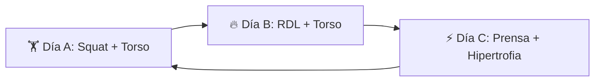

# 🏋️‍♂️ GUÍA MAESTRA DE ENTRENAMIENTO Y NUTRICIÓN VIGOREXIAPP

---

## 📋 Resumen del Ecosistema de Entrenamiento

VigorexiApp integra dos sistemas de entrenamiento de máxima evidencia científica para hipertrofia y ganancia de fuerza, seleccionables en la app móvil y en el reloj:

1. **⚡ PROGRAMA PRINCIPAL: FULL BODY CÍCLICO ROTATIVO (3 DÍAS - V2)**
   * **Enfoque:** Alta frecuencia y máxima hipertrofia con **mayor volumen en pecho, cuádriceps y gemelos**, manteniendo una gestión óptima de fatiga.
   * **Duración:** **~41 minutos** en versión completa (gracias a superseries agonista-antagonista, descansos eficientes y transiciones realistas de ~1 min) y **~32 a 36 minutos** en versión exprés.
   * **Intensidad:** RIR 1-2 en básicos y RIR 0-1 en accesorios y aislamiento.
   * **Ritmo de rotación flexible:** El ciclo A, B, C rota por sesiones, no por calendario fijo. Mínimo 3 por semana, máximo 3 seguidas, sin intentar recuperar entrenamientos perdidos.
2. **📋 PROGRAMA ALTERNATIVO: TORSO / PIERNA CLÁSICO (4 DÍAS)**
   * **Enfoque:** Distribución clásica con 2 días de torso y 2 días de pierna.
   * **Frecuencia:** Lunes - Martes - Jueves - Viernes.

---

## ⏱️ Protocolo de Calentamiento y Aproximación Rápido (2 Fases)

> [!IMPORTANT]
> **Las series de calentamiento NO cuentan como series de trabajo.** Su único fin es irrigar articulaciones y activar el sistema neuromuscular sin generar fatiga ni acumular lactato.

### Protocolo para el 1er gran básico del día (Sentadilla, RDL, Prensa 45°):

| Fase | Carga aprox. | Repeticiones | Descanso |
| :--- | :---: | :---: | :---: |
| **Fase 1 (Muy ligera)** | Barra sola o ~50% | 8 | **30 - 45 s** *(lo que tardas en colocar discos)* |
| **Fase 2 (Aproximación media)** | ~70% - 75% | 3 - 5 | **60 - 90 s** |
| **➡️ SERIE 1 EFECTIVA** | **100% peso objetivo** | **Reps objetivo (RIR 1-2)** | **Descanso oficial de la rutina** |

*Para los ejercicios secundarios siguientes (poleas, mancuernas, máquinas), basta con **1 serie previa de tanteo** (3-4 reps ligeras) para comprobar el ajuste del asiento y la resistencia.*

* **Excepción en Día A (Press de Banca):** Antes de la primera serie efectiva de Press de banca, realiza **1 serie de aproximación específica (~60% del peso objetivo × 5 reps con 45-60 s de descanso)** para aclimatar hombros y pectoral tras la sentadilla.

---

## 🔄 Dinámica de Superseries y Biseries

* **Superserie:** Pareja de ejercicios de músculos distintos o antagonistas (ej. Pecho + Espalda, Deltoides + Gemelos, Cuádriceps + Hombro). Se realiza una serie del ejercicio **A**, se pasa **inmediatamente sin descanso** al ejercicio **B**, y el **temporizador de descanso corre únicamente al terminar la serie de B**.
* **Biserie (Brazos / Accesorios):** Se alternan series de dos ejercicios (ej. Tríceps y Bíceps) con un descanso corto (**45 s**) tras cada serie individual para no acumular fatiga cruzada en el agarre.
* **Versión Exprés (⚡):** Si dispones de menos de 40 minutos o el tiempo apremia, activa el interruptor "⚡ Exprés" en la cabecera. La app ocultará los ejercicios prescindibles (**biserie de brazos, plancha y crunch**), permitiéndote finalizar en **~32-36 minutos** manteniendo intactos los estímulos principales.

---

## 📊 Volumen Semanal por Grupo Muscular (Rutina V2)

| Grupo Muscular | Series / Ciclo (3 sesiones) | Series Semanales (3 sesiones/sem) | Series Semanales (3.5 sesiones/sem) | Rango Óptimo Científico |
| :--- | :---: | :---: | :---: | :---: |
| **Pecho** | **11** (Banca 4 + Inclinado 4 + Aperturas 3) | **11** | **~13** | 10 - 16 series |
| **Espalda / Dorsal** | **11** (Jalón 4 + Remo 4 + Jalón neutro 3) | **11** | **~13** | 10 - 16 series |
| **Cuádriceps** | **9** (Sentadilla 3 + Extensión 3 + Prensa 3) | **9** | **~10.5** | 8 - 14 series |
| **Isquios / Cadena Post.** | **6** (RDL 3 + Curl femoral 3) | **6** | **~7** | 6 - 10 series |
| **Gemelos** | **6** (Talones pie Día A 3 + Día C 3) | **6** | **~7** | 6 - 10 series |
| **Deltoides Lateral** | **6** directas (Laterales mancuerna 3 + polea 3) | **6** | **~7** | 6 - 12 series |
| **Deltoides Posterior** | **3** directas (Face pull 3) + estímulo en remos | **3** | **~3.5** | 3 - 6 series |
| **Tríceps** | **6** directas (Polea 3 + Francés 3) + presses | **6** | **~7** | 6 - 10 series |
| **Bíceps** | **6** directas (Curl 3 + Martillo 3) + jalones | **6** | **~7** | 6 - 10 series |
| **Abdomen / Core** | **6** (Plancha 3 + Crunch 3) | **6** | **~7** | 4 - 8 series |

---

# ⚡ PROGRAMA 1: FULL BODY CÍCLICO ROTATIVO (3 DÍAS)



---

### 🗓️ DÍA A: Sentadilla Pesada + Torso
*Duración estimada: **~41 min** (Completa) / **~32 min** (Exprés) | Total: 23 series*

| # | Ejercicio | Series × Reps | Carga Ref. *(ajustar)* | RIR | Descanso |
| :-: | :--- | :---: | :---: | :---: | :---: |
| **1** | **Sentadilla trasera con barra (Back Squat)** | 3 × 6-8 | 100 kg | 1-2 | 120 - 150 s *(Fuerza Cuádriceps)* |
| **2a** | **⚡ SUPERSERIE: Press de banca plano con barra**<br>*Aprox. previa: ~60% × 5 reps (descanso 45-60 s)* | 4 × 6-8 | 80 kg | 1-2 | Inmediato a 2b |
| **2b** | **⚡ SUPERSERIE: Jalón al pecho prono (agarre ancho)** | 4 × 8-10 | 70 kg | 1-2 | **90 - 120 s tras la pareja** |
| **3a** | **⚡ SUPERSERIE: Elevaciones laterales con mancuernas** | 3 × 12-15 | 12 kg | 0-1 | Inmediato a 3b |
| **3b** | **⚡ SUPERSERIE: Elevación de talones de pie (gemelos)** | 3 × 12-15 | 70 kg *(pausa 1s abajo)* | 0-1 | **45 - 60 s tras la pareja** |
| **4a** | **[Exprés omite] Extensión de tríceps en polea alta** | 3 × 10-12 | 30 kg | 1 | ⚡ 45 s (Biserie con Bíceps) |
| **4b** | **[Exprés omite] Curl de bíceps con mancuernas** | 3 × 10-12 | 16 kg | 1 | ⚡ 45 s (Biserie con Tríceps) |

*Alternativas:*
* *Sentadilla trasera:* Sentadilla Hack en máquina | Prensa 45° | Sentadilla en Multipower.
* *Press banca plano:* Press con mancuernas en banco plano | Press plano en máquina convergente.
* *Jalón al pecho:* Dominadas asistidas o libres | Jalón unilateral en polea alta.
* *Elevación talones pie:* Gemelo en máquina de pie | Elevación talones en Multipower | Gemelo unilateral con mancuerna.

---

### 🗓️ DÍA B: Bisagra Cadera (RDL) + Torso
*Duración estimada: **~41 min** (Completa) / **~36 min** (Exprés) | Total: 23 series*

| # | Ejercicio | Series × Reps | Carga Ref. *(ajustar)* | RIR | Descanso |
| :-: | :--- | :---: | :---: | :---: | :---: |
| **1** | **Peso Muerto Rumano (RDL) con barra** | 3 × 8-10 | 90 kg | 1-2 | 120 - 150 s *(Cadena Post./Isquios)* |
| **2a** | **⚡ SUPERSERIE: Press inclinado con mancuernas (30°)**| 4 × 8-10 | 30 kg | 1-2 | Inmediato a 2b |
| **2b** | **⚡ SUPERSERIE: Remo en polea baja agarre neutro** | 4 × 8-10 | 65 kg | 1-2 | **90 - 120 s tras la pareja** |
| **3a** | **⚡ SUPERSERIE: Press militar sentado con mancuernas**| 3 × 8-10 | 24 kg | 1-2 | Inmediato a 3b |
| **3b** | **⚡ SUPERSERIE: Extensión de cuádriceps en máquina** | 3 × 12-15 | 55 - 60 kg | 0-1 | **75 - 90 s tras la pareja** |
| **4a** | **Face Pull en polea alta** | 3 × 12-15 | 25 kg | 1 | ⚡ 45 s (Biserie con Plancha) |
| **4b** | **[Exprés omite] Plancha abdominal isométrica** | 3 × 50-60 s | Peso corporal | — | ⚡ 45 s (Biserie con Face Pull) |

*Alternativas:*
* *RDL barra:* RDL con mancuernas pesadas | RDL en Multipower | Hip Thrust con barra.
* *Press inclinado:* Press inclinado en máquina | Press inclinado en Multipower.
* *Remo polea baja:* Remo unilateral con mancuerna *(conserva tu historial)* | Remo en máquina con apoyo en pecho.
* *Extensión cuádriceps:* Prensa 45° pies abajo | Sissy squat en máquina.

---

### 🗓️ DÍA C: Prensa + Torso y Brazos
*Duración estimada: **~41 min** (Completa) / **~32 min** (Exprés) | Total: 27 series*

| # | Ejercicio | Series × Reps | Carga Ref. *(ajustar)* | RIR | Descanso |
| :-: | :--- | :---: | :---: | :---: | :---: |
| **1a** | **⚡ SUPERSERIE: Prensa de piernas 45°** | 3 × 8-10 | Carga alta | 1-2 | Inmediato a 1b |
| **1b** | **⚡ SUPERSERIE: Curl femoral tumbado o sentado** | 3 × 10-12 | 50 kg | 1-2 | **90 s tras la pareja** |
| **2a** | **⚡ SUPERSERIE: Jalón al pecho agarre neutro cerrado**| 3 × 8-10 | 70 kg | 1-2 | Inmediato a 2b |
| **2b** | **⚡ SUPERSERIE: Aperturas en polea (o Pec Deck)** | 3 × 12-15 | 10 kg / lado | 1 | **75 - 90 s tras la pareja** |
| **3a** | **⚡ SUPERSERIE: Elevaciones laterales en polea** | 3 × 12-15 | 10 kg | 0-1 | Inmediato a 3b |
| **3b** | **⚡ SUPERSERIE: Elevación de talones de pie (gemelos)**| 3 × 12-15 | 70 kg | 0-1 | **45 - 60 s tras la pareja** |
| **4a** | **[Exprés omite] Press francés con mancuernas o barra Z**| 3 × 10-12 | 32 kg | 1 | ⚡ 45 s (Biserie con Martillo) |
| **4b** | **[Exprés omite] Curl martillo con mancuernas** | 3 × 10-12 | 16 kg | 1 | ⚡ 45 s (Biserie con Francés) |
| **5** | **[Exprés omite] Crunch en polea alta arrodillado** | 3 × 12-15 | 40 kg | 1 | 60 s *(Recto Abdominal)* |

*Alternativas:*
* *Prensa 45°:* Sentadilla búlgara con mancuernas (20 kg) | Hack squat en máquina.
* *Aperturas en polea:* Pec deck (contractora) | Cruces en polea media | Press en máquina convergente.
* *Curl femoral:* Curl femoral unilateral de pie | Curl nórdico asistido.
* *Crunch polea:* Rueda abdominal | Elevación de piernas colgado.

---

## 🔄 Reglas de Ritmo Flexible y Gestión de Fatiga

El ciclo A, B, C rota **por sesiones realizadas**, no por días fijos de calendario.

```
Día A ──> Día B ──> Día C ──> Día A ──> Día B ... (rotación continua)
```

1. **Frecuencia semanal:** Entrena un **mínimo de 3 sesiones por semana** para asegurar el estímulo hipertrófico óptimo, y un **máximo de 3 días seguidos** para evitar sobrecarga del sistema nervioso y articular.
2. **Sin recuperar sesiones perdidas:** Si un día no puedes ir al gimnasio por trabajo o imprevistos, simplemente descansas. En la siguiente sesión ejecutas el día que correspondía en la rotación; **nunca dobles entrenamientos ni intentes compensar**.
3. **Entrenamientos en días seguidos:** Si entrenas dos días consecutivos (por ejemplo, Día A y luego Día B), la app te avisará en cabecera: en el segundo día, deja **2 a 3 repeticiones en reserva (RIR 2-3)** en los ejercicios pesados de pierna y bisagra de cadera.
4. **Vuelta tras un parón (5 o más días sin entrenar):** Tras 5 o más días de inactividad, empieza la primera sesión con **un 5% a 10% menos de peso** en todos los ejercicios para readaptar tendones y evitar dolor muscular tardío (agujetas incapacitantes).
5. **Semana de descarga (Deload) cada 6 a 8 semanas:**
   * Tras 6-8 semanas de progresión lineal ininterrumpida, realiza 1 semana de descarga activa.
   * **Cómo hacerla:** Mantén la misma rutina pero realiza la mitad de las series (o RIR 3-4 con cargas moderadas). Permite disipar la fatiga acumulada en tejido conectivo y sistema nervioso central.
6. **Pausa de dieta (Diet Break) cada 8 a 12 semanas en déficit:**
   * En fases de definición o pérdida de grasa, tras 8 a 12 semanas de déficit calórico continuo, introduce **1 semana a calorías de mantenimiento** (subiendo hidratos de carbono saludables).
   * Ayuda a la adherencia psicológica y a reducir la fatiga acumulada del déficit continuo; la evidencia científica de otros efectos metabólicos o de reactivación hormonal es limitada.

---

# 📋 PROGRAMA 2: TORSO / PIERNA CLÁSICO (4 DÍAS)
*Para periodos donde prefieras separar 100% tren superior y tren inferior.*

### DÍA 1: LUNES – TORSO A (Empuje)
1. Press de banca plano barra: $4 \times 6\text{--}8$ (80 kg) | 120-150 s
2. Jalón al pecho prono ancho: $4 \times 8\text{--}10$ (70 kg) | 90-120 s
3. Press militar sentado mancuernas: $3 \times 8\text{--}10$ (24 kg) | 90 s
4. Remo en polea baja neutro: $3 \times 10\text{--}12$ (65 kg) | 90 s
5. Elevaciones laterales mancuernas: $3 \times 12\text{--}15$ (12 kg) | 75 s
6. Biserie Brazos (Extensión tríceps $3 \times 10\text{--}12$ + Curl bíceps $3 \times 10\text{--}12$) | 45 s

### DÍA 2: MARTES – PIERNA A (Cuádriceps)
1. Sentadilla trasera con barra: $3 \times 6\text{--}8$ (100 kg) | 150-180 s
2. Extensiones de cuádriceps en máquina: $3 \times 10\text{--}12$ (60 kg) | 90 s
3. Curl femoral tumbado: $3 \times 10\text{--}12$ (45 kg) | 90 s
4. Elevación de talones de pie: $3 \times 12\text{--}15$ (70 kg) | 60 s
5. Plancha abdominal isométrica: $3 \times 45\text{--}60\text{ s}$ | 45 s

### DÍA 3: JUEVES – TORSO B (Tracción)
1. Remo unilateral con mancuerna: $4 \times 8\text{--}10$ (34 kg) | 90-120 s
2. Press inclinado mancuernas: $4 \times 8\text{--}10$ (30 kg) | 90-120 s
3. Jalón neutro cerrado: $4 \times 8\text{--}10$ (70 kg) | 90-120 s
4. Elevaciones laterales polea: $3 \times 12\text{--}15$ (10 kg) | 75 s
5. Face pull en polea alta: $3 \times 12\text{--}15$ (25 kg) | 60 s
6. Biserie Brazos (Press francés $3 \times 10\text{--}12$ + Curl martillo $3 \times 10\text{--}12$) | 45 s

### DÍA 4: VIERNES – PIERNA B (Isquios & Cadena Posterior)
1. Peso Muerto Rumano (RDL): $3 \times 8\text{--}10$ (90 kg) | 120-150 s
2. Sentadilla búlgara con mancuernas: $3 \times 8\text{--}10$ / pierna (20 kg) | 90 s
3. Curl femoral sentado: $3 \times 10\text{--}12$ (55 kg) | 90 s
4. Extensiones de cuádriceps: $3 \times 12\text{--}15$ (55 kg) | 75 s
5. Elevación de talones sentado: $3 \times 12\text{--}15$ (45 kg) | 60 s
6. Crunch en polea alta: $3 \times 12\text{--}15$ (40 kg) | 60 s

---

# 🥗 GUÍA NUTRICIONAL Y FISIOLÓGICA PERSONALIZADA (DANI)

### 📊 Diagnóstico y Objetivos
* **Edad:** 39 años | **Altura:** 173 cm | **Peso:** 72 kg | **Tasa Metabólica Basal:** $1.610 \text{ kcal}$
* **Objetivo:** **Recomposición Corporal Estética.** Reducción de grasa subcutánea manteniendo íntegra la masa magra y la fuerza, mejorando la vascularización y el tono muscular.

> [!NOTE]
> **Expectativas en fase de déficit:** Durante un déficit calórico, **mantener las cargas y la fuerza en los ejercicios básicos ya es un excelente resultado adaptativo** (indica preservación total del tejido muscular). El control de la grasa no se mide por la báscula de un solo día (fluctuaciones de agua y glucógeno), sino por la **tendencia del promedio semanal de peso**.

### 🔢 Números Diarios Clave
* **Calorías Objetivo:** **$\mathbf{1.850\text{ a }1.900\text{ kcal/día}}$** (Déficit controlado del 15%).
* **Proteína:** **$150\text{ g/día}$** ($2.1\text{ g/kg}$) $\rightarrow$ Preservación de masa magra y alta saciedad.
* **Grasas Saludables:** **$60\text{ g/día}$** ($0.85\text{ g/kg}$) $\rightarrow$ Soporte hormonal y salud articular.
* **Carbohidratos:** **$175\text{ g/día}$** ($2.4\text{ g/kg}$) $\rightarrow$ Glucógeno muscular y rendimiento en los básicos.
* **Creatina Monohidrato:** **5 g diarios fijos** todos los días (con o sin entreno).

### ⏰ Distribución Peri-Entreno para las 15:15
1. **13:00 (Comida Ligera Pre-Entreno):**
   * Pollo/pavo a la plancha (100 g) o atún al natural + 50-60 g de arroz blanco o 200 g de patata cocida + verduras ligeras al vapor.
   * *Baja en grasa para permitir vaciado gástrico rápido en 2 horas.*
2. **15:15 (Entrenamiento Full Body - ~41 min):**
   * Agua abundante (750 ml). Opcional: café solo 40 min antes de salir de la oficina.
3. **17:30 - 18:00 (Merienda Fuerte Post-Entreno):**
   * Batido de proteína Whey (30 g) + 5 g de creatina monohidrato + 1 plátano maduro o tortitas de avena.
   * Cena temprana nutritiva: pescado azul (salmón o merluza), ensalada completa y huevo.
4. **Ventana de Ayuno Nocturno (Ocasional):**
   * El ayuno nocturno de 12-14 horas es una herramienta **ocasional y de conveniencia horaria**, no diaria ni mágica para oxidar grasas. En los días en que se realice, procura repartir tus comidas para **llegar igualmente a la meta diaria de ~150 g de proteína**.
