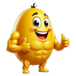

# Plan Definitivo: Coach Mascota v1.8.4

> Estado: **Aprobada y en ejecución — Tanda 1 (rev13)**
> Base: commit `37cc69a` (`fix: sincronizar selector de dias y cambio de rutina 3D a 4D`), árbol limpio.
> Versión actual del Service Worker: `rev12`.

## Hoja de ruta

| Fase | Contenido | Caché | Estado |
| :--- | :--- | :--- | :--- |
| **TANDA 1** | Mascota interactiva (`#mascotBtn`), modal Coach Vigorex, badge PR/Fatiga/Inactividad, personalidad, asistente de sobrecarga de solo lectura, `getWeightStep` y tests. | **rev13** | **En ejecución** |
| **PARADA** | Validación real en gimnasio por el usuario. | — | — |
| **TANDA 1.5** | Globo contextual sobre la cabecera (auto-cierre 5 s). | rev14 | Aprobada en diseño; no implementar aún. |
| **TANDA 2** | Modo cansado, Gym SOS, hora estimada de salida y sello en Flex Card. | rev15 | Congelada. |

---

## TANDA 1 (rev13)

### 1. Cabecera y gesto táctil

**Markup**

```html
<button type="button" id="mascotBtn" class="header-mascot-wrap" aria-haspopup="dialog" aria-label="Abrir coach">
  
  <span class="mascot-badge" id="mascotBadge" aria-hidden="true"></span>
</button>
```

- Sin `onclick` inline ni `title`.
- `.header-mascot-wrap` mide `44 × 44 px`, con `margin: -3px 0` para no alterar la fila de 38 px.
- `.header-mascot-img` mide 32 × 32 px.
- Badge en `top: 2px; right: 2px`, `pointer-events: none`.
- PR: `🔥` a 14 px. Fatiga: punto ámbar de 8 px con borde `2px solid var(--bg)`. Inactividad: `💤` a 14 px.
- Pulso solo dentro de `@media (prefers-reduced-motion: no-preference)`.

**Gesto**

- `pointerdown` (botón primario) inicia un temporizador de **450 ms**.
- Al cumplirse: `navigator.vibrate?.(30)`, `showToast(fraseAleatoriaSegunPerfil)`, `suppressClick = true` y **no se abre el modal**.
- `pointerup`, `pointercancel` y `pointerleave` solo cancelan el temporizador.
- `click` abre el modal únicamente si `suppressClick` es falso; si es verdadero, consume el evento y lo resetea.
- Guarda `if (overlay.classList.contains('open')) return;` para evitar aperturas duplicadas.
- `contextmenu` y `dragstart` se bloquean con `preventDefault()`.
- Enter/Espacio funcionan por ser un `<button>` nativo.

### 2. Micro-estados y prioridad

`getConsecutiveTrainingAlert()` devuelve `type`:

- `'inactivity'`: 5 días o más sin entrenar.
- `'fatigue'`: 3 o más días consecutivos.
- `'yesterday'`: entrenó ayer; **no pinta badge**.

`getMascotState()` respeta este orden:

1. Hay PR en la sesión actual → `'pr'`.
2. Alerta de fatiga → `'fatigue'`.
3. Alerta de inactividad → `'inactive'`.
4. En cualquier otro caso → `'normal'`.

`aria-label` del botón:

- Normal: `Abrir coach`.
- PR: `Abrir coach. Nuevo récord personal`.
- Fatiga: `Abrir coach. Aviso de fatiga`.
- Inactividad: `Abrir coach. Días sin entrenar`.

Refresco del badge: carga inicial, `selectDay`, `completeSet`, `checkExerciseCardCompletion`, `executeDayArchive` y cambio de personalidad.

### 3. Personalidad

- `workoutState.coachPersonality`: `'sargento' | 'ciencia' | 'gymbro'`.
- Etiqueta visual de `'gymbro'`: **Colega**. Default: `'gymbro'`.
- Persistencia en **tres puntos**:
  1. Literal inicial de `workoutState` (junto a `lastActivityTime`).
  2. Defaults de `loadWorkoutState()`.
  3. Whitelist de `sanitizeImportedState()`.
- Cualquier valor inválido o ausente se normaliza a `'gymbro'`.
- Frases en español neutro, sin nombres propios.
- Sin TTS: el long-press usa solo `showToast` + háptica.

### 4. Asistente de sobrecarga (100 % solo lectura)

- `getWeightStep(ex) = Number(ex && ex.stepKg) || 2.5` (helper global; no modifica el motor existente).
- `supportsLoadProgression(ex)`: excluye isometría, exige que `dose` contenga `reps` y que `target.max > 0`.
- `computeDoubleProgression(exId, ex, sets)`:
  - **Precedencia absoluta**: si `getFreshOverload(exId)` devuelve una sugerencia vigente, se muestra tal cual (`nextKg` / `baseReps`).
  - Series de trabajo: `kg > 0 && reps > 0`.
  - Si la sesión aún no tiene series con reps, usa la última entrada de `exerciseHistory[exId]`.
  - `lastKg = Math.max(...workSets.map(s => s.kg))`.
  - `setsAtLastKg = workSets.filter(s => s.kg === lastKg)`. Si hay 2 o más, evalúa solo esas; si no, evalúa todas las series de trabajo.
  - Si **todas** las series evaluadas alcanzaron `target.max`: sugiere `lastKg + getWeightStep(ex)` y `target.min` reps.
  - Si no: sugiere mantener `lastKg` y buscar `min(target.max, max(target.min, minReps + 1))`.
  - Peso corporal (`workSets.length === 0` y hay reps): compara reps. Si todas al techo, sugiere lastre o reps extra; si no, `min(target.max, max(target.min, minReps + 1))`.
  - Isometría o dosis sin reps: no sugiere kg; propone progresar por segundos o series.
  - Sin datos: `"Sin historial: registra una sesión para calcular la progresión."`
- Casos de referencia:
  - `70×10, 75×8, 80×5` → **80 kg × 6 reps**.
  - `70×10, 80×8, 80×8` (objetivo 6-8) → **82.5 kg × 6 reps**.
  - `pec_deck` (`stepKg: 5`) al techo → **+5 kg**.
- El asistente **nunca** escribe en `overloadSuggestions`.

### 5. Récords personales (PR)

Punto único: `completeSet()` cuando la serie pasa a `done`.

- **1RM**: si `curKg > 0` y `curReps > 0`, compara `calculate1RM(curKg, curReps)` contra el máximo `best1RM` del historial. Solo hay PR si `prevBest1RM > 0` y el nuevo valor lo supera.
- **Isometría**: si `curReps > prevBestSecs && prevBestSecs > 0`. Se conserva el toast existente; el PR no añade otro toast.
- **Peso corporal** (`curKg === 0`, no isometría): compara `curReps` contra el máximo `bestReps` de entradas con `bestKg === 0` o sin `bestKg`. Exige `prevBest > 0`.
- `sessionPRSet` guarda **una marca por `exId` y sesión**.
- `markExercisePR()` dispara `navigator.vibrate?.([40,60,40])`, actualiza el badge y **no muestra toast**.
- Sin persistencia adicional: el PR se conserva en el historial al archivar la sesión.
- Reset de `sessionPRSet` y `lastPRInfo` al cambiar de día de entrenamiento y al finalizar `executeDayArchive`.
- El badge muestra `🔥` mientras exista al menos un PR en la sesión.

### 6. Modal Coach Vigorex

- `.modal-overlay` + `.modal-sheet`, con `.open` y `body.modal-open`.
- `role="dialog"`, `aria-modal="true"`, `aria-labelledby="coachModalTitle"`.
- Cierre por backdrop (solo si `event.target === overlay`), botón ✕, botón “Entendido” y `Escape`.
- Al abrir: guarda `document.activeElement`, enfoca el botón de cierre y registra el listener de teclado.
- Al cerrar: elimina el listener y devuelve el foco a `#mascotBtn`.
- `Tab` y `Shift+Tab` ciclan entre cerrar, chips y “Entendido”.
- Secciones:
  1. Briefing: racha (`calculateStreak`), último entrenamiento (`getDayLastDoneInfo`) y siguiente recomendado (`getNextRecommendedDay`).
  2. Chips de personalidad con `aria-pressed`.
  3. Tarjeta de sobrecarga; se oculta si no hay ejercicio activo o si la vista es Historial/Rutina.
  4. Píldora de truco de la app.
  5. Footer con “Entendido”.

### 7. Tests (`tests/coach_mascot_test.js`)

1. `#mascotBtn` es un `<button>` accesible, sin `onclick` y con badge `aria-hidden`.
2. Cache `rev13` y registro `sw.js?v=1.8.4-rev13`.
3. Personalidad válida e inválida en la whitelist.
4. `getConsecutiveTrainingAlert` devuelve `inactivity`, `fatigue` y `yesterday`.
5. PR de 1RM.
6. PR de isometría.
7. PR de peso corporal (ignora entradas con lastre).
8. PR una sola vez por ejercicio y reset de sesión.
9. Rampa `70/75/80` → 80 × 6.
10. Rampa `70/80/80` al techo → 82.5.
11. `pec_deck` → +5 kg.
12. Precedencia de `getFreshOverload`.
13. Sin ejercicio activo / sin historial.
14. Paridad de `getWeightStep` en los 101 ejercicios del catálogo.

### 8. Cierre de Tanda 1

- `sw.js`: `CACHE_NAME = 'vigorexiapp-v1.8.4-rev13'`.
- Registro del Service Worker en `index.html` con `?v=1.8.4-rev13`.
- Sección “Coach Mascota” en `INVENTARIO_FUNCIONES.md`.
- Toda la suite de `tests/*.js` en verde.
- **PARADA**: esperar la prueba real en gimnasio antes de la Tanda 1.5.

---

## Tanda 1.5 (diseño aprobado, no implementar)

- Capa absoluta en `.app-header`: `top: var(--safe-top); right: 0; bottom: 0; left: 0; z-index: 2`.
- `<span>` de texto con `role="status" aria-live="polite"`.
- Prioridad: PR > sobrecarga > briefing.
- Auto-cierre a los 5 s con pausa real (hover/foco).
- Supresión si hay un input enfocado, el modal está abierto o el globo ya se mostró para ese ejercicio.
- Sets `bubbleShown` / `bubbleDismissed` con clave `` `${dayId}:${exId}` ``.
- Reset en `selectDay` y al archivar.
- Sin persistencia, TTS ni vibración.
- Preguntas abiertas: `blur()` al detectar PR, auto-avance sin globo, briefing al abrir día y equivalencia “globo == autorrelleno”.

## Tanda 2 (congelada)

- Modo cansado, Gym SOS (3 escenarios), hora estimada de salida y sello Flex Card.
- `mascot.png` se dibuja a un máximo de 112 px en la Flex Card.
